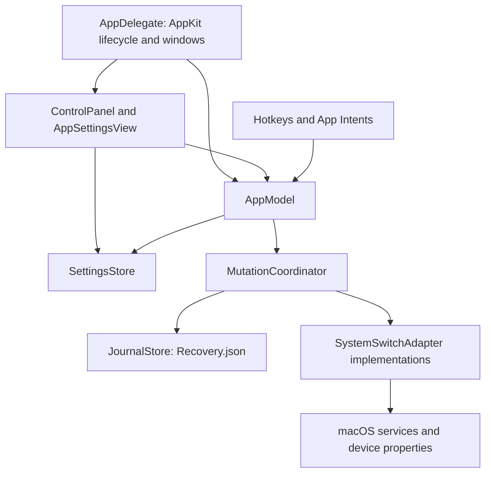

# Architecture

MacWindowHide is a local macOS menu bar utility. Recording Mode applies a selected set of system changes and later restores the changes it still owns. It prepares a screen; it does not capture video or automatically detect screen sharing.

Read [AGENTS.md](AGENTS.md) for contribution instructions, [README.md](README.md) for build/install commands, and [the verification report](docs/VERIFICATION.md) for executed checks and remaining device coverage. This document describes the implementation, including its current limits.

## Runtime and boundaries



There is one application target and one app-hosted XCTest target. Source folders are organizational boundaries, not separate Swift modules.

| Boundary | Source of truth | Responsibility |
| --- | --- | --- |
| Lifecycle | [AppLifecycle.swift](MacWindowHide/Presentation/AppLifecycle.swift) | Starts `NSApplication`, retains its delegate, owns the status item, popover and Settings window, and coordinates termination. |
| Application model | [AppModel.swift](MacWindowHide/Presentation/AppModel.swift) | Creates settings and adapters, forwards observed state, tracks the external foreground PID, registers hotkeys and runs the clock task. |
| UI | [ControlPanel.swift](MacWindowHide/Presentation/ControlPanel.swift), [SettingsView.swift](MacWindowHide/Presentation/SettingsView.swift) | Renders actual state, edits preferences, and invokes model/coordinator operations. |
| Automation | [AutomationIntents.swift](MacWindowHide/Presentation/AutomationIntents.swift) | Maps Shortcuts/Siri operations onto the same model and coordinator used by the UI. |
| Shared types | [Models.swift](MacWindowHide/Core/Models.swift) | Stable control identifiers, adapter contract, snapshots, preferences and settings persistence. |
| Mutation policy | [MutationCoordinator.swift](MacWindowHide/Core/MutationCoordinator.swift) | Recording lifecycle, ownership, timers, recovery and published status. |
| Durable operations | [JournalStore.swift](MacWindowHide/Core/JournalStore.swift) | Versioned journal serialization, validation and durable replacement. |
| System controls | [SystemAdapters.swift](MacWindowHide/Platform/SystemAdapters.swift) | Appearance, Dock, display settings, Keep Awake, alerts and Screen Saver. |
| Audio/devices | [AudioBluetoothAdapters.swift](MacWindowHide/Platform/AudioBluetoothAdapters.swift) | Paired headphones, audio routing, microphone controls and device snapshots. |
| Visual controls | [VisualAdapters.swift](MacWindowHide/Platform/VisualAdapters.swift) | Adapter factories, desktop/backdrop/menu wrappers and hidden-app ownership ledger. |
| Window rendering | [BackdropController.swift](MacWindowHide/Platform/BackdropController.swift) | Desktop covers, foreground-window backdrops and shared palettes. |
| Menu bar engine | [MenuBarController.swift](MacWindowHide/Platform/MenuBarController.swift) | Shelf assignments, reveal behavior and OS-specific visibility strategies. |
| Input filtering | [KeyboardLockController.swift](MacWindowHide/Platform/KeyboardLockController.swift) | Dedicated event-tap worker, synchronized safety state and mouse-accessible unlock UI. |

`AppDelegate` skips normal startup when hosted by XCTest. Preserve this guard: loading tests must not initialize the real application model, request permissions or start system integrations.

Normal startup creates `AppModel.shared`, starts recovery, then refreshes status. The model's one-second task updates displayed time and calls `tick()`. The coordinator queries system state periodically only while a recording or auto-off timer is active; opening the popover and explicit Refresh also request status.

Switch mutations and recording operations pass through the coordinator. Settings changes are saved directly by `SettingsStore`. Menu shelf editing/reveal commands and backdrop appearance refreshes currently use `AppModel` controller helpers outside the coordinator; they are configuration paths, not a second recording engine.

## Adapter contract and concurrency

`SystemSwitchAdapter` is a `@MainActor` class protocol:

```swift
var id: SwitchID { get }
func capability() async -> SwitchCapability
func status() async -> SwitchStatus
func snapshot() async throws -> ResourceSnapshot
func apply(enabled: Bool, context: ActionContext) async throws
func restore(_ snapshot: ResourceSnapshot, context: ActionContext) async throws
func matches(_ snapshot: ResourceSnapshot) async throws -> Bool
func shutdown()
```

- `capability()` distinguishes available, missing setup/permission and unsupported implementations. Recording preflight checks every selected adapter before mutation.
- `status()` distinguishes on, off, partial, unknown, needs permission and unsupported. `isEnabled` includes partial; it does not imply that every hardware input is muted or every screen configuration is covered.
- `ResourceSnapshot` stores string fields; complex adapter records are JSON encoded inside those fields. Each adapter owns its snapshot format and interpretation.
- `apply` verifies the relevant result where the platform exposes it. `matches` supplies the restoration ownership comparison. Its default is full snapshot equality; lease-based adapters override it with effective-state comparisons.
- `ActionContext` identifies `standalone` versus `recording` ownership and carries the captured foreground PID. `shutdown` releases controller resources after coordinated restoration.

The coordinator, model, settings and AppKit controllers use the main actor. Actor isolation alone does not prevent interleaving at `await`: `operationInFlight`, `tickInFlight` and countdown generation tokens prevent conflicting work. Only the operation that set `operationInFlight` clears it: `refresh` and `recover` are refused while `isBusy` (including the countdown), and preparation after a countdown refuses to start if another operation holds the guard.

Busy entrypoints return rather than enqueueing another operation. `startRecording`, `stopRecording`, `setSwitch`, `scheduleAutoOff`, `refresh`, `recover` and `toggleRecording` return `false` when they refuse a request because of a running operation, quitting, or unresolved recovery, and `true` when the request ran (including a no-op). Hotkeys and buttons may drop a refused request. App Intents go through [AutomationRequest.swift](MacWindowHide/Core/AutomationRequest.swift): they wait up to five seconds for a running operation (not a countdown), then throw `SwitchError.busy` or the pending-recovery issue for a refused request. Only an issue produced by the accepted request is reported, never a stale one. In `recoveryNeeded`, Recording Mode toggles and `stopRecording` run full `recover()`, not only the recording owner's changes, so standalone records are reconciled before mutations are re-enabled.

Blocking child processes run through [ProcessRunner.swift](MacWindowHide/Platform/ProcessRunner.swift), using argument arrays, detached work, concurrent pipe readers, cancellation and a timeout. Bluetooth connection work also leaves the main actor. The keyboard tap has a separate thread/run loop and an `NSLock`-protected safety state; event filtering does not wait for AppKit updates.

## Recording, ownership and recovery

The recording phases are:

```text
idle → countdown (optional) → preparing → active → restoring → idle
                                                 ↘ recoveryNeeded
```

Startup recovery also enters `restoring`. A read or restoration failure leaves an explicit recovery-needed state; another recording cannot start until it is resolved.

### Apply and restore sequence

1. Read the selected controls in configured order and preflight their capabilities.
2. Run the optional cancellable countdown. Take each original snapshot immediately before its mutation.
3. Persist a `prepared` change containing its UUID, switch ID, owner, original snapshot, requested Boolean and foreground PID.
4. Apply through the adapter, read the actual resulting snapshot, then persist it as `applied`.
5. Once preparation succeeds, save session start/end times and publish `active`.
6. On stop or preparation failure, process recording changes in reverse order. Remove the session only when its changes have been retired.

`prepared` entries contain a requested Boolean, not a full intended-state snapshot. If a crash occurs before the actual snapshot is recorded, recovery compares the original state and uses `status().isEnabled` versus that requested Boolean to infer ownership. This is a limited recovery heuristic, not proof of invisible user intent.

For applied entries, restoration compares the current resource against the original and last app-applied snapshots using the adapter's `matches` method. A different value is left alone. Periodic refresh also removes ownership and its timer when an external divergence is observed. Transient resources may still need their owner-specific lease released even when their effective state already matches the original.

The journal is written before each mutation and restoration step. `JournalStore` creates a private temporary file, writes all bytes, synchronizes storage with `F_FULLFSYNC` or `fsync`, renames it atomically, then synchronizes the directory. Loading rejects unsupported journal versions, duplicate operation UUIDs and unknown timer IDs. A corrupt journal remains evidence; it is not silently replaced during recovery.

### Standalone use and timers

There is one absolute auto-off deadline per switch. Recording temporarily owns selected controls; their preexisting standalone deadlines remain in the journal.

- Expired standalone timers are deferred while Recording Mode owns the same control, except Keep Awake's independent standalone lease can expire immediately.
- A manual switch change releases its recording ownership, cancels its previous timer and applies the new standalone operation.
- Persistent standalone choices generally remain selected across Quit. Desktop/backdrop covers, hidden apps, menu restrictions, Keep Awake and keyboard locking are transient and released on normal shutdown.
- Alert and microphone original snapshots are retained separately from ordinary persistent toggles so turning them off after relaunch can restore exact baseline values.
- Keep Awake clock mode stores `awakeUntil` as an absolute date (the persisted format is unchanged). A future date is used as chosen. A date that has passed is treated as a time of day: the deadline is its next occurrence, so a stale setting never produces a past deadline.
- Recovery reconciles unfinished recording changes rather than restarting Recording Mode. Unexpired standalone Keep Awake/desktop/backdrop timers can recreate their process-owned resources; keyboard locking never resumes.

Keep Awake, covers and menu controls maintain standalone/recording ownership within their controllers. Releasing one owner must preserve the other's effect. Hidden apps additionally require per-process ownership rather than a single global Boolean.

Normal Quit invokes `shutdown()`. It cancels a countdown and blocks new operations. It waits (up to 20 seconds) for an in-flight operation instead of skipping restoration. Then it restores recording changes, processes standalone timers that expired while recording owned their switch, restores transient standalone changes and releases controllers. `shutdown()` returns `true` only when nothing it owns remains unresolved and the reconciled journal has been saved again (a repeated Quit after a failed final write cannot succeed from in-memory state alone); a successful retry clears an earlier `recoveryNeeded`. If the operation does not finish or restoration fails, it returns `false` with an issue, and the delegate keeps the app running. If the journal could not be read, every mutation was refused, so the process owns no change: Quit is allowed and the unreadable file is left untouched for the next launch. Windows, event taps and IOPM assertions are process resources; their native objects disappear after process death even if journal metadata remains.

All Quit buttons and menu commands call `NSApplication.terminate`; the delegate owns the single asynchronous cleanup task. Its first response is `terminateCancel`, keeping the normal event loop available while cleanup runs. Duplicate requests remain cancelled. After cleanup succeeds, the delegate marks termination ready and calls `terminate` again, returning `terminateNow`. Do not use `terminateLater` here: its modal run loop can stall the Swift main-actor task needed to finish cleanup. Failed restoration opens Settings and retains recovery evidence; the clock task is cancelled only after successful cleanup.

### Hidden application ledger

`OtherAppsAdapter` keeps `HiddenApps.json` alongside the general journal because a multi-application operation can fail between individual hides. It writes each owner claim before hiding that app and retains a claim until unhide succeeds or becomes unnecessary.

Identity is bundle ID + PID + launch time. Restoration only unhides the surviving matching instance; it never launches a replacement. The utility, Finder, foreground app and configured exclusions remain visible. Preexisting hidden apps are skipped unless already owned. An observed user unhide releases the matching claims.

## Platform integration map

| Feature | Mechanism | Permission or limit |
| --- | --- | --- |
| Desktop icons/widgets | Stationary wallpaper cover windows below normal app windows; desktop clicks are intercepted. | Files and Finder visibility preferences remain untouched. |
| Backdrop | Borderless, nonactivating, mouse-transparent windows ordered below a foreground `CGWindowID`; wallpaper/image rendering is local. | Uses metadata, not screenshots. A windowless target yields an unavailable or partial result. |
| Hide other apps | `NSRunningApplication.hide/unhide` with the durable per-owner ledger. | No general window-position or Space-management engine. |
| Dock, whole menu bar, Dark Mode | Fixed System Events AppleScript properties. | Automation consent; checks avoid prompting during routine status reads. |
| Menu icon shelves | Separator geometry on macOS 15/26; private native visibility assertions on macOS 27+. | Accessibility; macOS 27 groups by owner application and retains some system indicators. |
| Night Shift / True Tone | Runtime-loaded CoreBrightness clients. | Private ABI and hardware support checks can produce unsupported state. |
| Screen Saver | Launch system `ScreenSaverEngine.app`. | Start-only action; App Intents rejects an off request. |
| Keep Awake | IOPM idle-display-sleep assertion per owner. | Explicit Sleep and lid-close behavior are preserved. |
| AirPods/headphones | IOBluetooth paired-device connection, CoreAudio route selection, optional runtime battery selectors. | Bluetooth consent; connection alone is not proof of correct audio routing. |
| Alert mute | Standard Additions alert-volume reads/writes with readback. | Independent of media volume. |
| Microphone mute | CoreAudio writable mute, otherwise writable per-device/per-channel input gain, with readback. | Some devices cannot be muted; snapshots identify devices by persistent UID. |
| Keyboard lock | Active session event tap and an independent safety worker. | Accessibility; timeout, held-Escape, mouse unlock, sleep/session/permission loss fail open. |

The explicit System Events setup action launches the target if needed and calls `AEDeterminePermissionToAutomateTarget` with consent prompting enabled on a detached task. Routine capability checks keep prompting disabled. Settings prevents duplicate requests and reports success, denied access with instructions, or the macOS error; a generic application-name AppleScript read is not used as a consent trigger.

Private calls are isolated in [PrivateDisplayBridge.m](MacWindowHide/Platform/PrivateDisplayBridge.m) and [MenuBarNativeBridge.m](MacWindowHide/Platform/MenuBarNativeBridge.m), imported through the bridging header. They validate runtime availability/signatures and return explicit failures. The current backdrop engine uses public window ordering; it does not contain a SkyLight fallback.

The menu controller owns reveal/rehide timers, cached AX inventory and generation checks for asynchronous native assertions. Recording suppresses automatic hover reveal. Native macOS 27 restrictions can affect Notification Center; legacy notch/overflow behavior needs device validation. Source attribution is in [VISUAL_SOURCES.md](docs/VISUAL_SOURCES.md) and [THIRD_PARTY_NOTICES.md](THIRD_PARTY_NOTICES.md).

Microphone state is enumerated when queried. The current implementation does not install a hot-plug listener that automatically mutes every newly attached input; mixed inputs are reported as partial, and restoration compares recorded UID controls while ignoring newly added devices. Preserve this distinction in product claims.


## Local storage and compatibility

`SettingsStore.directory` defaults to `~/Library/Application Support/MacWindowHide`; `MACWINDOWHIDE_DATA_DIR` redirects it for isolated runs.

| Item | Owner | Persistence behavior |
| --- | --- | --- |
| `Settings.json` | `SettingsStore` | Atomic encoding of `AppPreferences` on changes; unreadable/incompatible settings currently fall back to defaults. |
| `Recovery.json` | `JournalStore` | Versioned durable operation/session records and absolute timer deadlines. |
| `HiddenApps.json` | `OtherAppsAdapter` | Durable per-owner claims and running-process identities. Corruption blocks this adapter. |
| `Images/` | `AppModel` | Imported, validated backdrop images copied into application storage. |
| UserDefaults | AppKit / KeyboardShortcuts | Status-item placement and recorded hotkeys; these do not use the data-directory override. |

`SwitchID.rawValue`, snapshot fields and owner strings are persisted interfaces. Changes require compatibility handling for existing recovery records. Settings and the hidden-app ledger do not currently share the journal's explicit version field; avoid describing them as a unified versioned database.

Do Not Disturb was removed on 25 October 2026. Its raw identifier `doNotDisturb` remains decode-only as `retiredDoNotDisturb`, excluded from active controls, timers, defaults, hotkeys and App Enum choices. Loading settings filters its saved selections and timer defaults while preserving other preferences. Old Shortcut invocations are rejected before initializing the app model. There is no Focus adapter, helper invocation or bundled setup guide.

Version-1 journals retain old DND snapshots and deadlines in optional `retiredChanges` and `retiredTimers` fields. Loading moves only that retired control out of active work in memory; the source file remains unchanged until the next durable save. Recovery continues restoring other controls and never reads or writes macOS Focus. Archived operation IDs remain part of duplicate validation; unknown timers and invalid archived entries still fail closed. Removing the feature leaves any current macOS Focus unchanged rather than guessing how to restore it.

There is no application backend, account, telemetry or update service. The app is unsandboxed with Hardened Runtime and the Apple Events entitlement. Screen Recording and microphone-recording permissions are unnecessary for the current integrations.

## Build, tests and extension points

[generate_project.py](scripts/generate_project.py) is authoritative for target membership, build settings, entitlements, linkage and the shared scheme. The checked-in Xcode project is generated output. Swift/Objective-C sources and tests are discovered from their folders; resource membership is listed explicitly in the generator. Make structural project changes there, then regenerate.

KeyboardShortcuts is a pinned local Swift package under `Vendor/KeyboardShortcuts`; its package manifest determines the minimum Swift tools requirement. See the scripts and README for current build commands and environment overrides.

Build/test DerivedData lives under `/private/tmp` because cloud-synced Documents can reattach Finder metadata that invalidates bundle signatures. `build/Products/MacWindowHide.app` is a symlink to the clean Release bundle, not the durable installer. Packaging stages outside Documents and creates the DMG; verification mounts it read-only and checks integrity, signature, architectures, resources and checksum.

For a new control, extend `SwitchID` and its capability flags, implement/register an adapter in the appropriate factory, and update App Enum display representations plus the relevant UI/settings. Decide its standalone/timer/recording ownership semantics in the coordinator before enabling it in a profile. Keep platform failures explicit and preserve existing journal compatibility.

Tests are organized by boundary:

- [MutationCoordinatorTests.swift](MacWindowHideTests/MutationCoordinatorTests.swift): fake adapters, fault injection, durable journal behavior, ownership, timers and shutdown.
- [KeyboardSafetyTests.swift](MacWindowHideTests/KeyboardSafetyTests.swift): deterministic safety state without installing a tap.
- [VisualRecoveryTests.swift](MacWindowHideTests/VisualRecoveryTests.swift): stale/reused process identity and corrupt-ledger handling without hiding live apps.

`python3 scripts/test_quit.py` launches the built app with fresh temporary data and `--quit-smoke-test`, invokes the same model Quit entrypoint from a Swift task, and requires normal process exit within ten seconds. This runs the actual AppKit lifecycle without changing switches; it caught the original nested-termination hang. It supplements hosted unit tests, whose startup guard intentionally skips real app initialization.

The native smoke mode uses only desktop cover, backdrop and Keep Awake, restores them and emits a JSON result. It requires a GUI session and a usable foreground window; it does not prove every display/Space configuration or other controls. The historical executed results and outstanding physical/TCC/Shortcuts checks belong in [VERIFICATION.md](docs/VERIFICATION.md), not in a stale test-count claim here.
